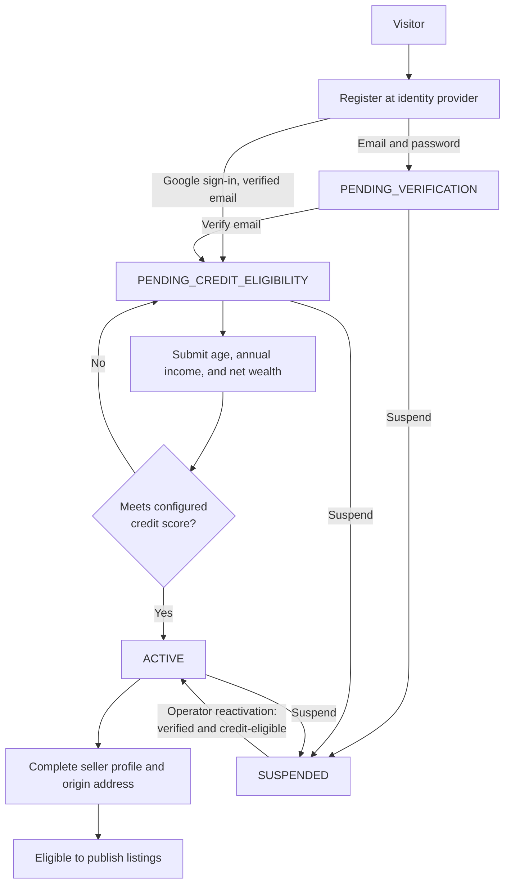

# Auction Platform Requirements

## 1. Purpose

This document defines the product and technical requirements for version 1 of an online auction platform. The platform is implemented as a Kotlin/Ktor modular monolith and contains four business subsystems:

1. User onboarding
2. Product catalog
3. Bidding
4. Settlement

The system supports timed English auctions for single-quantity physical goods. One verified account may participate as both buyer and seller.

## 2. Scope

### 2.1 In scope

- Registration and authentication through a self-hosted identity provider (Keycloak) offering Google sign-in and email-and-password accounts, email verification, and in-application profile management.
- Seller enablement through completion of required seller and shipping information.
- Creation, publication, discovery, and lifecycle management of auction listings.
- Fixed-deadline ascending-price bidding with atomic bid acceptance.
- Winner selection and order creation when an auction closes.
- Checkout through an external payment provider.
- Shipment and delivery status tracking.
- Auditability of security-sensitive and financial state changes.

### 2.2 Out of scope

- Reserve prices, proxy bidding, buy-now sales, sealed bids, and anti-sniping extensions.
- Bid withdrawal or editing.
- Multi-quantity listings, digital goods, services, and local pickup.
- Multiple currencies or currency conversion.
- Platform wallets or escrow.
- Tax calculation, disputes, automated refunds, and an administrator moderation UI.
- Manual approval of every listing.

## 3. Actors

- **Visitor:** An unauthenticated user who can register, verify an email address, sign in, and browse public auctions.
- **Buyer:** An active, verified user who can place bids, view bidding history, and settle won auctions.
- **Seller:** An active, verified user with a complete seller profile who can manage and publish listings and fulfill paid orders.
- **Payment provider:** An external system that accepts payment and reports payment outcomes by webhook.
- **System operator:** A trusted operator who can suspend accounts and diagnose operations through secured administrative mechanisms. A dedicated admin UI is not part of v1.

## 4. Shared Business Rules

- All authoritative timestamps use UTC and are generated or validated by the server.
- All auctions use one deployment-configured ISO 4217 currency.
- Monetary values are stored and exchanged as integer minor units. Floating-point values are prohibited for money.
- Public identifiers are opaque and must not expose sequential database keys.
- Authenticated operations require an active account. Bid placement and listing publication also require a verified email and successful credit-eligibility assessment.
- State transitions must be validated on the server and recorded with actor, timestamp, entity identifier, and transition details.
- Validation errors use stable machine-readable error codes with human-readable messages.
- Retried commands that can create financial or auction state must accept or derive an idempotency key.

## 5. Subsystem Requirements

### 5.1 User onboarding

#### Capabilities

- **USR-001:** A visitor can register through the identity provider either with Google sign-in or with a unique normalized email address and password. A Google identity whose verified email matches an existing account links to that account; it never creates a second one.
- **USR-002:** Password policy and storage are the identity provider's responsibility: passwords must meet a configurable minimum policy and be stored only as hashes produced by a memory-hard algorithm. The application never receives, logs, or stores a password.
- **USR-003:** Email-and-password registration triggers a single-use, expiring verification email from the identity provider. A Google identity with a verified email is treated as verified on first sign-in.
- **USR-004:** A user must have a verified email before bidding or publishing a listing. The application enforces this from its own account state, not from the token alone.
- **USR-005:** A user authenticates with the identity provider through the OpenID Connect authorization-code flow with PKCE and receives a short-lived JWT access token and a rotating refresh token issued by the provider. The application accepts only access tokens it has validated against the provider's published signing keys, issuer, and audience.
- **USR-006:** Refresh tokens are rotated on every use, invalidated on reuse, revocation, expiry, or account suspension, and never stored by the application. These behaviours are enforced by identity-provider configuration that is versioned with the application.
- **USR-007:** A user can view and update their display name, contact details, shipping address, and seller profile.
- **USR-008:** A user becomes eligible to sell only after supplying all configured seller-profile and origin-address fields.
- **USR-009:** One account can act as both buyer and seller; no separate role registration is required.
- **USR-010:** Account suspension immediately prevents authentication refresh, bidding, listing publication, and fulfillment updates. Suspension disables the identity-provider account so that sign-in and refresh fail, and sets the application account state so that access tokens issued before suspension are rejected. Existing records remain available for audit and operational resolution.
- **USR-011:** After email verification, a user supplies their age, annual income, and net wealth for an internally calculated credit-eligibility assessment. Income and wealth are expressed in integer minor units.
- **USR-012:** The server evaluates the supplied values using a versioned, deployment-configured scoring policy. An account becomes active only when it meets the configured minimum score. The assessment outcome, policy version, and timestamp are auditable; raw assessment inputs are encrypted at rest, excluded from logs, and retained only according to the applicable data-retention policy.
- **USR-013:** The application keeps its own account record for every user, keyed by the identity provider's stable subject identifier and exposed through an opaque public user id. The record is created on the user's first authenticated request, in `PENDING_VERIFICATION` when the token's email is unverified and in `PENDING_CREDIT_ELIGIBILITY` when it is verified. Display name and email are copied from the token on creation and refreshed when the provider reports a change.
- **USR-014:** Identity-provider configuration (realm, clients, Google identity brokering, password policy, token lifetimes, brute-force protection, required actions) is exported and versioned in the repository, and every environment is created from that export.

#### Account states

`PENDING_VERIFICATION -> PENDING_CREDIT_ELIGIBILITY -> ACTIVE -> SUSPENDED`

- Successful email verification at the identity provider moves an account from `PENDING_VERIFICATION` to `PENDING_CREDIT_ELIGIBILITY`; the application learns of it from the `email_verified` claim on the next request or from a provider event. Google sign-ins with a verified email enter directly at `PENDING_CREDIT_ELIGIBILITY`.
- A successful credit-eligibility assessment moves an account from `PENDING_CREDIT_ELIGIBILITY` to `ACTIVE`; an unsuccessful assessment leaves the account pending and returns a stable reason.
- Suspension may occur from `PENDING_VERIFICATION`, `PENDING_CREDIT_ELIGIBILITY`, or `ACTIVE`.
- Reactivation is an operator action and returns the account to `ACTIVE` only when its email has been verified and it has passed credit eligibility.

#### Onboarding flow

### 5.2 Product catalog

#### Capabilities

- **CAT-001:** An eligible seller can create a draft listing for exactly one physical item.
- **CAT-002:** A listing contains a title, description, category, condition, one or more image references, starting price, shipping price or free-shipping indicator, origin details, start time, and end time.
- **CAT-003:** The end time must be later than the start time and both must satisfy configurable scheduling limits.
- **CAT-004:** The starting price and shipping price cannot be negative; the starting price must be greater than zero.
- **CAT-005:** A seller may edit a listing while it is `DRAFT` or `SCHEDULED`. Changes that affect auction economics are prohibited after the auction becomes `ACTIVE`.
- **CAT-006:** A valid draft can be published without manual review. Publication moves it to `SCHEDULED`, or directly to `ACTIVE` when its start time has arrived.
- **CAT-007:** Visitors can browse and search `SCHEDULED`, `ACTIVE`, `SOLD`, and `UNSOLD` listings by text, category, status, price range, and end time.
- **CAT-008:** Listing results support stable pagination and documented sorting options.
- **CAT-009:** A seller may cancel an auction only before its first accepted bid. Cancellation is final.
- **CAT-010:** At the end time, a listing with at least one accepted bid becomes `SOLD`; otherwise, it becomes `UNSOLD`.

#### Listing states

`DRAFT -> SCHEDULED -> ACTIVE -> SOLD | UNSOLD`

`DRAFT | SCHEDULED | ACTIVE(no bids) -> CANCELLED`

- The scheduler activates due `SCHEDULED` listings and closes due `ACTIVE` listings.
- State-transition jobs must be safe to retry and must tolerate application restarts.

### 5.3 Bidding

#### Capabilities and rules

- **BID-001:** An active, verified buyer can submit a bid to an `ACTIVE` auction before its end time.
- **BID-002:** A seller cannot bid on their own listing.
- **BID-003:** The first bid must be at least the starting price.
- **BID-004:** Each subsequent bid must be at least the current highest bid plus the deployment-configured minimum increment.
- **BID-005:** A bid is immutable after acceptance and cannot be withdrawn.
- **BID-006:** Bid acceptance uses the server timestamp and occurs in one database transaction.
- **BID-007:** Concurrent bids must be serialized using database locking, optimistic concurrency with retry, or an equivalent mechanism. A bid is accepted only if it is valid against the latest committed highest bid.
- **BID-008:** Each accepted bid receives a strictly increasing auction-local sequence number, providing a deterministic ordering when timestamps are equal.
- **BID-009:** The auction winner is the bidder associated with the final accepted highest bid at closing.
- **BID-010:** A bidder can view their own complete bid history. Public bid history must mask bidder identity and expose only information approved for public display.
- **BID-011:** A rejected bid changes no auction state and returns a stable reason such as `AUCTION_NOT_ACTIVE`, `AUCTION_ENDED`, `SELLER_CANNOT_BID`, `BID_TOO_LOW`, or `ACCOUNT_NOT_ELIGIBLE`.
- **BID-012:** Retrying bid submission with the same bidder and idempotency key returns the original result rather than creating another bid.

The authoritative deadline rule is `receivedAt < auction.endAt`. A bid received at or after `endAt` is rejected, even if the closing job has not yet updated the listing state.

### 5.4 Settlement

#### Capabilities and rules

- **SET-001:** Closing a sold auction creates exactly one order for the winning bidder and seller.
- **SET-002:** The order total is the winning bid plus the listing's shipping price, expressed in the configured currency.
- **SET-003:** A new order is `PAYMENT_PENDING` and has a payment deadline 24 hours after auction closure by default. The duration is configurable.
- **SET-004:** The winning buyer can initiate or resume checkout through a provider-neutral payment integration while payment is pending.
- **SET-005:** Payment initiation and webhook processing are idempotent. Duplicate provider events must not duplicate payments, orders, or state transitions.
- **SET-006:** A verified provider webhook is authoritative for successful payment. Browser redirects alone cannot mark an order paid.
- **SET-007:** Failed payment attempts leave the order `PAYMENT_PENDING` while time remains. An unpaid order becomes `PAYMENT_EXPIRED` after its deadline.
- **SET-008:** After payment, the seller can record the shipping carrier and tracking reference, moving the order to `SHIPPED`.
- **SET-009:** Delivery may be confirmed from a trusted carrier update or by the buyer, moving the order to `DELIVERED`.
- **SET-010:** Only the winning buyer can access checkout details, and only the order's seller can submit fulfillment information.
- **SET-011:** Payment-provider secrets and raw sensitive payment data must not be stored in application logs or domain tables.
- **SET-012:** Refund and dispute automation is outside v1. Operator-assisted exceptions must be auditable and cannot rewrite the original winning bid.

#### Order states

`PAYMENT_PENDING -> PAID -> SHIPPED -> DELIVERED`

`PAYMENT_PENDING -> PAYMENT_EXPIRED`

- A `PAYMENT_FAILED` result is recorded as a payment-attempt outcome, not a terminal order state while the payment window remains open.
- Terminal order states in v1 are `DELIVERED` and `PAYMENT_EXPIRED`.

## 6. API Requirements

The application exposes versioned JSON REST endpoints under `/api/v1`. Concrete request and response DTOs may evolve, but the following capabilities and policies are required.

### 6.1 User onboarding API

- Registration, email verification, sign-in, token refresh, and sign-out are provided by the identity provider's standard OpenID Connect endpoints, not by the application API.
- Get the authenticated user's account (creating it on first call per USR-013) and update the authenticated user's profile.
- Submit credit-eligibility inputs and retrieve the authenticated user's current assessment outcome and stable eligibility reason, without exposing the score or scoring-policy details.
- Complete seller-profile information.
- Access tokens issued by the identity provider are sent as bearer tokens. Refresh tokens are held by the client's OpenID Connect library through a transport and storage mechanism appropriate for the client threat model; the application never sees them.
- Every authenticated endpoint authorizes against the application account state (USR-004, USR-010, USR-012), never against token validity alone.

### 6.2 Product catalog API

- Create, read, update, publish, and cancel the authenticated seller's listings.
- Retrieve a public listing and search public listings using pagination and filters.
- Mutation responses return the resulting resource version to support concurrency control.

### 6.3 Bidding API

- Submit a bid with auction identifier, amount in minor units, currency, and idempotency key.
- Retrieve public masked bid history for a listing.
- Retrieve the authenticated user's bids.
- Successful bid responses include accepted amount, sequence number, acceptance timestamp, and current auction price.

### 6.4 Settlement API

- Retrieve orders won by the authenticated buyer or sold by the authenticated seller.
- Initiate or resume external checkout for a pending order.
- Receive signed payment-provider webhook events.
- Record shipment and confirm delivery subject to authorization.

### 6.5 HTTP behavior

- Use `400` for malformed input, `401` for missing or invalid authentication, `403` for prohibited operations, `404` for unavailable resources, `409` for state or concurrency conflicts, and `422` for validly formed requests that violate domain rules.
- Errors contain a correlation identifier, stable code, message, and optional field-level details.
- Collection endpoints provide bounded pagination and reject page sizes above the configured maximum.
- Financial and state-changing endpoints support idempotency and document how conflicting reuse of a key is handled.

## 7. Modular Monolith Architecture

### 7.1 Technology baseline

- Kotlin on JVM 21.
- Ktor for HTTP transport and application hosting.
- Gradle Kotlin DSL with a multi-project build.
- PostgreSQL as the transactional database.
- Exposed for database access and transaction management.
- Flyway for versioned database migrations.
- Keycloak as the OpenID Connect identity provider, brokering Google and hosting email-and-password accounts; the application integrates only through standard OIDC (discovery, JWKS, token claims) and the Keycloak admin API for suspension.

### 7.2 Gradle modules

- **`app`:** Ktor startup, configuration, routing assembly, dependency wiring, authentication installation, schedulers, and process lifecycle.
- **`shared-kernel`:** Stable primitives such as typed identifiers, money, clocks, pagination contracts, and event envelope types.
- **`user-onboarding`:** Account records keyed by provider subject, verification-state projection, profiles, eligibility rules, seller enablement, and the identity-provider adapter (token claims in, suspension out). No credentials or tokens are stored here.
- **`product-catalog`:** Listings, categories, images, scheduling, discovery, and listing lifecycle.
- **`bidding`:** Bids, bid validation, price progression, concurrency control, and winner determination.
- **`settlement`:** Orders, payment attempts, payment-provider integration, shipment, and delivery.

Each business module is internally organized into:

- `api`: Public commands, queries, results, and events available to other modules.
- `application`: Use-case orchestration and transaction boundaries.
- `domain`: Entities, value objects, policies, and domain services with no Ktor, Exposed, or provider dependencies.
- `infrastructure`: Database repositories, external adapters, schedulers, and transport mapping.

### 7.3 Boundary rules

- A business module may depend on `shared-kernel` and another module's `api`, but not another module's application, domain, or infrastructure packages.
- Cyclic Gradle module dependencies are prohibited.
- Modules cannot read or write another module's tables or call another module's repository implementation.
- `app` assembles implementations but contains no auction business rules.
- `shared-kernel` must remain small and cannot become a home for subsystem-specific logic.
- Each module owns its Flyway migrations and table definitions. Migrations are packaged and applied in a deterministic order by the assembled application.

### 7.4 Module collaboration

- Synchronous cross-module commands or queries use explicit Kotlin interfaces exposed from the provider module's `api` package.
- Cross-module reactions use immutable domain events with a unique event ID, event type, aggregate ID, occurrence time, payload version, and correlation ID.
- State changes and their outgoing events are committed atomically to an outbox table in the same database transaction.
- An asynchronous dispatcher delivers pending events with at-least-once semantics, bounded retry, backoff, and observable failure state.
- Event consumers are idempotent and record processed event IDs when their operation cannot otherwise be made naturally idempotent.
- Event payloads are versioned. Breaking event changes require a new version and a compatible migration period.

Expected event flows include:

- Account suspension informs modules that enforce participation eligibility.
- Auction closure publishes either an auction-sold or auction-unsold event.
- Settlement consumes auction-sold to create the winning order exactly once.
- Payment confirmation makes the order eligible for fulfillment.

### 7.5 Deployment model

- All modules compile into one application artifact and run in one process. The identity provider is the single sanctioned exception: Keycloak runs as its own deployment with its own database schema, and the application depends on it only over OpenID Connect and its admin API.
- The application uses one PostgreSQL deployment with exclusive logical table ownership per module.
- The HTTP server, scheduled auction lifecycle work, and outbox dispatcher may run in the same deployment, but jobs must use database coordination so multiple application instances are safe.
- Configuration is supplied through environment variables or external configuration; secrets are never committed to source control.

## 8. Non-functional Requirements

### 8.1 Correctness and reliability

- Bid acceptance and auction closure must preserve a single deterministic winning bid under concurrency.
- Scheduled work, payment callbacks, and event processing must be safe to retry after crashes.
- Database transactions must not include slow calls to external payment or email providers.
- The service must expose liveness and readiness endpoints. Readiness fails when required infrastructure is unavailable.

### 8.2 Security and privacy

- Production traffic requires TLS.
- Authorization is enforced in application use cases as well as at transport boundaries where appropriate.
- Passwords, tokens, payment secrets, and sensitive personal data are redacted from logs.
- Sensitive configuration is loaded from secret-capable environment configuration.
- Login, token refresh, and verification abuse controls are provided by the identity provider's brute-force protection and must be enabled in its versioned configuration. The payment-webhook endpoint and the account bootstrap endpoint require application-side rate limiting or equivalent controls.
- Personal and financial records follow the deployment jurisdiction's retention and deletion policy.

### 8.3 Observability

- Emit structured logs containing timestamp, severity, service version, module, correlation ID, and safe entity identifiers.
- Propagate correlation IDs through HTTP requests, domain events, and external-provider calls.
- Record metrics for request latency and errors, bid acceptance and rejection, auction closure lag, payment outcomes, outbox backlog, retries, and dead-lettered events.
- Record onboarding and authentication metrics: registration, verification, sign-in, refresh, assessment, and seller-enablement outcomes by stable code; refresh-token rotation and reuse; verification-email dispatch delay; credit-assessment outcomes by policy version; rate-limit activations.
- Metric names, labels, and log fields never carry personal data, credentials, tokens, or credit-assessment inputs; stable outcome codes and policy versions are permitted.
- Audit account state changes, listing publication and cancellation, accepted bids, auction closure, payment transitions, and fulfillment transitions.

### 8.4 Performance baseline

- API pagination limits and database indexes must prevent unbounded catalog or bid-history queries.
- Bid placement, sign-in, and token refresh must meet documented service-level targets under expected peak concurrency; the targets must be established before production launch through load testing.
- Auction-closing delay and outbox-delivery delay must be measured and alerted on against configured operational thresholds.

### 8.5 Service levels

- Every user-facing subsystem has documented service-level indicators and objectives before production launch. The targets live in operational documents under `docs/` (for example `docs/M2_ONBOARDING_SLO.md`), are reviewed after the first 30 days of production traffic, and are revised there without changing this document.
- Each subsystem's indicators cover at least: availability of its API routes, server-side latency per endpoint, lag of its asynchronous steps (email, events, scheduled jobs), and the correctness invariants of section 9 as zero-tolerance signals.
- Indicators are measured server-side in the application and are independent of the web client's hosting.
- Alerting is based on error-budget burn rate over multiple windows, with minimum-traffic guards so that low traffic does not page. Correctness-invariant signals, readiness failures, and outbox backlog alert without a traffic guard.
- A written error-budget policy states what happens when a subsystem's budget is exhausted.
- Service levels are set for the deployed topology; a target that the current instance count or database tier cannot honour is not adopted until the topology changes.

## 9. Acceptance and Test Requirements

### 9.1 User onboarding

- A first authenticated request from an email-and-password identity creates a `PENDING_VERIFICATION` account that cannot bid; the same request from a Google identity with a verified email creates a `PENDING_CREDIT_ELIGIBILITY` account.
- A Google sign-in whose verified email matches an existing account links to it; no second account exists afterwards.
- An access token whose `email_verified` claim is false is refused for bidding and publishing even when the token is valid.
- Email verification moves the account to credit-eligibility pending; a passing assessment activates it, and a failing assessment prevents bidding and listing publication.
- Credit-eligibility inputs are evaluated with the configured policy version and never appear in application logs.
- Against a provider created from the versioned configuration: a verification link works once and fails after use or expiry; refresh rotates the token and reuse of a rotated token ends the session; password policy and brute-force protection reject weak passwords and repeated failures.
- A suspended account cannot sign in or refresh at the provider, and an access token issued before suspension is rejected by the application for bidding, publishing, and fulfillment updates.
- Tokens signed by any key other than the configured provider's, or with a wrong issuer or audience, are rejected.
- Completing required seller fields enables listing publication without creating a second account.

### 9.2 Product catalog

- Invalid prices, missing required fields, and invalid schedules prevent publication.
- A valid listing follows the `DRAFT -> SCHEDULED -> ACTIVE` lifecycle.
- A listing with no bids can be cancelled; one with an accepted bid cannot.
- Closing produces `SOLD` with bids and `UNSOLD` without bids.
- Activation and closing jobs can run more than once without duplicate transitions.

### 9.3 Bidding

- The first bid at the starting price succeeds; lower bids fail.
- Later bids below the current price plus minimum increment fail.
- Seller, suspended-user, early, and late bids fail with the documented reason.
- A bid timestamped exactly at the deadline fails.
- Simultaneous valid bids yield a deterministic committed order and exactly one highest bid.
- Reusing an idempotency key returns the first result without an additional bid.

### 9.4 Settlement

- Closing a sold auction creates exactly one order for the final highest bidder.
- Duplicate auction-sold events do not create duplicate orders.
- Browser payment redirects do not mark an order paid.
- A valid success webhook marks the order paid once; duplicate webhooks have no additional effect.
- Failed attempts permit another checkout attempt before the deadline.
- An unpaid order expires after the payment window.
- Only the order seller can mark it shipped, and only an eligible actor or trusted carrier update can confirm delivery.

### 9.5 Architecture and integration

- Architecture tests detect forbidden module dependencies, cycles, infrastructure imports in domain packages, and direct cross-module persistence access.
- Domain tests cover state transitions and monetary rules without infrastructure.
- Ktor route tests cover authentication, authorization, validation, and error contracts.
- PostgreSQL integration tests use an isolated real database, such as Testcontainers, and verify Exposed mappings, locks, transactions, outbox behavior, and Flyway migrations.
- End-to-end tests cover registration through delivery, including process restart with pending scheduled work and outbox events.

## 10. Definition of Done

A feature is complete only when:

- Its requirement identifiers are implemented and traceable to tests.
- Public APIs and events are documented and backward-compatible within their published version.
- Authorization, validation, audit, logging, and metrics are included.
- Database migrations work both on an empty database and when upgrading the previous supported schema.
- Module-boundary and automated behavior tests pass.
- No secret or sensitive user/payment data appears in source control, application logs, or test fixtures.
